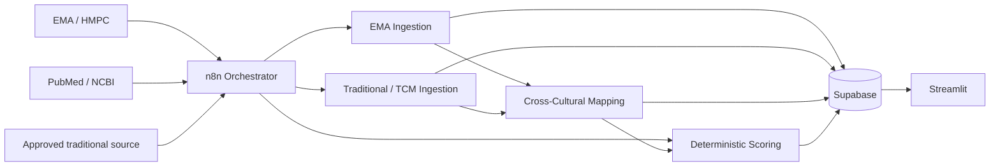
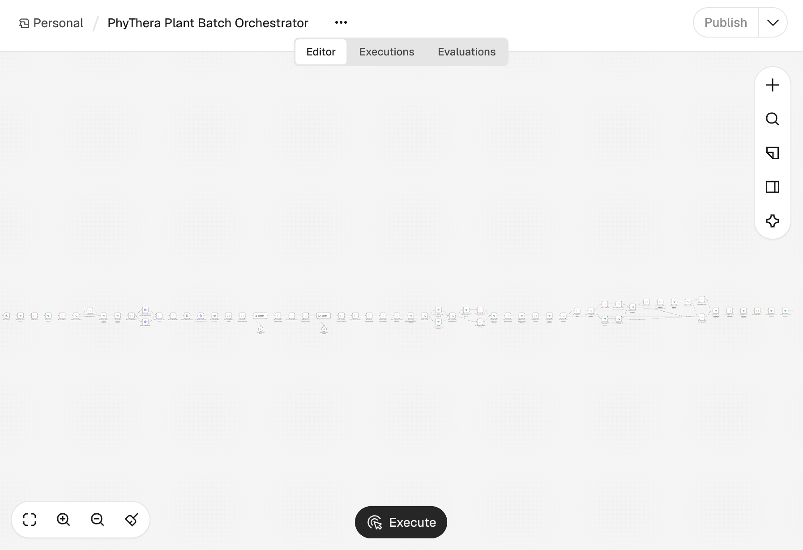
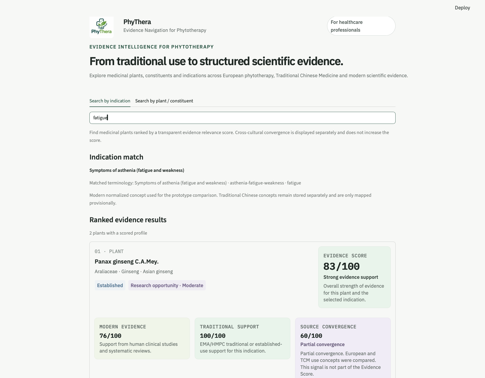
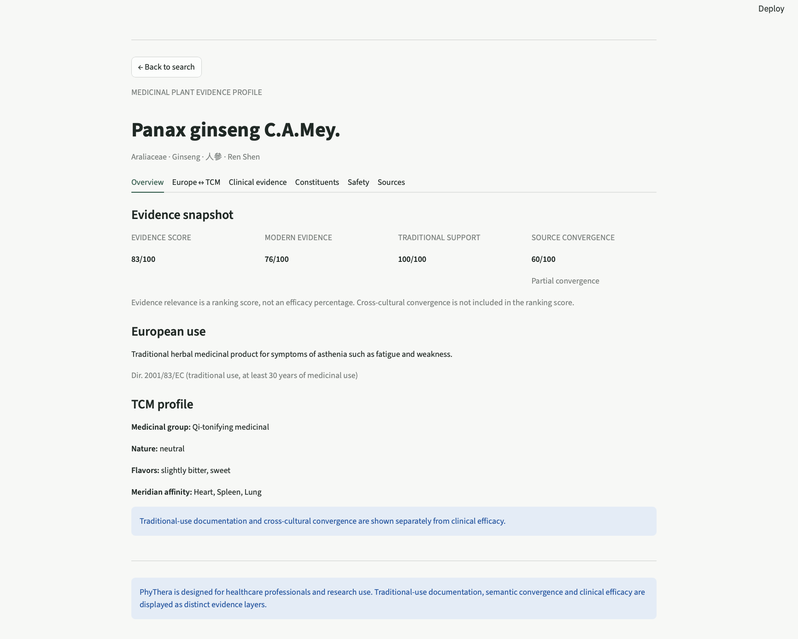
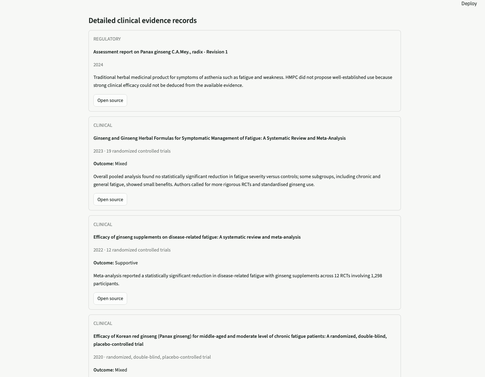
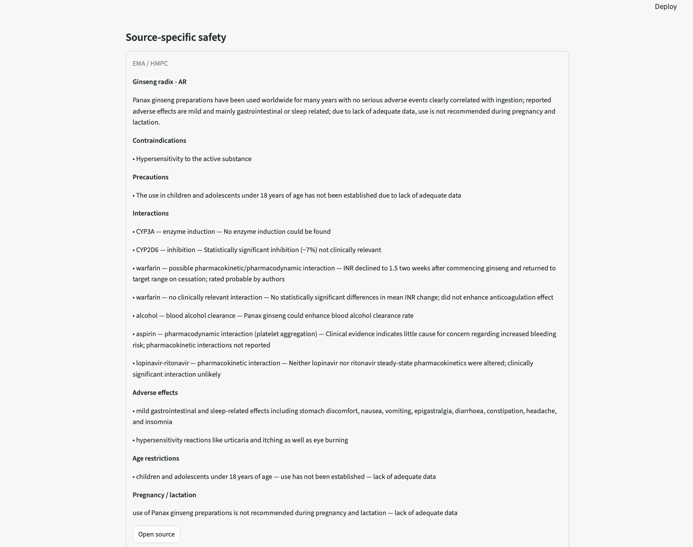
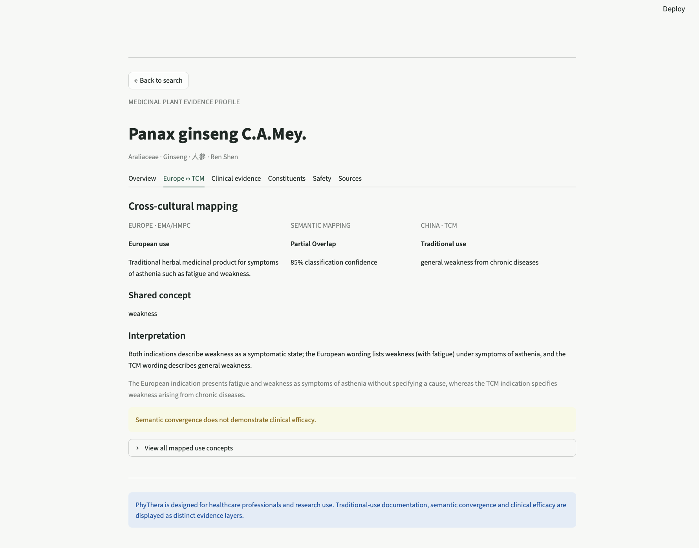

# PhyThera

**From traditional use to transparent scientific evidence.**

PhyThera is an EthnoHack 2026 research prototype for navigating medicinal-plant evidence across **modern clinical literature, European phytotherapy/regulatory sources, and source-specific traditional-use knowledge**.

Rather than presenting all evidence as equivalent, PhyThera keeps these dimensions separate, scores them transparently, and shows when a comparison is **not assessable** because a source layer is missing.

> Research prototype only. Not medical advice or clinical decision support. See [DISCLAIMER.md](DISCLAIMER.md).

---

## Why this matters

Medicinal-plant knowledge is fragmented across:
- traditional-use sources,
- regulatory monographs and assessment reports,
- modern clinical literature,
- safety and constituent data.

A search for a plant or indication therefore often requires manual comparison of heterogeneous sources. PhyThera turns that process into an auditable evidence-navigation workflow.

### Core principle

**Connect evidence without conflating it.**

- Modern clinical evidence stays distinct from traditional/regulatory support.
- Cross-cultural similarity stays distinct from clinical efficacy.
- Missing evidence is not treated as negative evidence.
- AI assists extraction and semantic comparison; deterministic code calculates scores.

---

## What PhyThera does

For a plant–indication profile, PhyThera can:

1. ingest and structure EMA/HMPC assessment information,
2. retrieve relevant PubMed literature through NCBI E-Utilities,
3. screen and group publications into evidence families,
4. calculate a deterministic Modern Evidence Score,
5. calculate regulatory/traditional support,
6. optionally ingest an explicitly authorised traditional source,
7. map European and traditional-use concepts,
8. calculate Source Convergence separately,
9. store provenance and derived profiles in Supabase,
10. rank and explore results in a Streamlit frontend.

At submission time, the internal prototype database contains **11 medicinal plants** spanning different evidence-coverage scenarios.

---

## Architecture



See [docs/architecture.md](docs/architecture.md) for details.



---

## Technology stack

| Component | Technology | Role |
|---|---|---|
| Database | Supabase / PostgreSQL | Persistent structured evidence and provenance |
| Orchestration | n8n | Multi-step ingestion and scoring workflows |
| AI layer | LLM via OpenRouter-compatible workflow | Structured extraction and semantic mapping |
| Literature | NCBI E-Utilities / PubMed | Modern clinical evidence retrieval |
| Frontend | Streamlit | Search, ranking and evidence-profile exploration |
| Language | Python + JavaScript in n8n code nodes | Frontend/data access + workflow logic |

---

## Evidence model

PhyThera exposes four complementary dimensions:

### Evidence Score
The main ranking score for a plant–indication profile.

Base weighting:
- **70% Modern Evidence**
- **30% Traditional Support**

If one component is unavailable, weights are renormalized across available evidence rather than treating missing data as zero.

### Modern Evidence
Derived from PubMed evidence families, indication match and outcome direction.

### Traditional Support
Derived from EMA/HMPC regulatory/traditional-use context.

### Source Convergence
A separate semantic comparison of European and traditional-use concepts.

**Source Convergence is not part of the Evidence Score and does not demonstrate clinical efficacy.**

Full rules: [docs/scoring.md](docs/scoring.md).

---

## Responsible AI

PhyThera follows:

> **AI where it helps. Deterministic logic where it matters.**

AI-assisted in the application:
- structured extraction from complex documents,
- semantic cross-cultural mapping.

Deterministic:
- evidence scoring,
- evidence categories,
- missing-data handling,
- source convergence,
- source-policy enforcement,
- provenance consistency checks.

### AI usage disclosure

| AI / tool | Where it was used | Purpose |
|---|---|---|
| **LLM via an OpenRouter-compatible workflow** | PhyThera runtime / n8n workflows | Schema-bound extraction from complex source documents and semantic mapping between source concepts. AI output is validated before storage; final evidence scores are calculated by deterministic rules. |
| **ChatGPT (OpenAI)** | Development support | Assistance with generating and refining Python, JavaScript and SQL code, debugging, workflow logic, data-model and scoring discussions, and technical documentation. The n8n workflows themselves were manually assembled and configured by the team. |
| **ChatGPT (OpenAI)** | Submission and communication | Assistance with drafting and refining README/Devpost text and with the structure, wording and creation/refinement of the presentation. Final content was reviewed and edited by the team. |

AI was not used to autonomously build or deploy the n8n workflows, generate the final Evidence Score, or make clinical recommendations. Source-derived results remain linked to their provenance, and AI-assisted outputs should not be interpreted as validated medical evidence on their own.

More: [docs/responsible_ai.md](docs/responsible_ai.md).

---

## Repository structure

```text
PhyThera/
├── README.md
├── DISCLAIMER.md
├── LICENSE
├── frontend/
│   ├── app.py
│   ├── components.py
│   ├── data.py
│   ├── requirements.txt
│   ├── Dockerfile
│   ├── assets/
│   └── .streamlit/
├── workflows/
├── database/
│   ├── schema.sql
│   └── rls_demo_readonly.sql
├── docs/
└── scripts/
```

---

# Quick start: frontend

The frontend can be run independently of n8n if it is connected to a compatible Supabase database.

## Option A — Python / Streamlit

### Prerequisites
- Python 3.12+
- `pip`
- Git

### 1. Clone the repository

```bash
git clone https://github.com/Gammon712/makeathon-2026-phythera-digital-health-phytotherapy.git phythera
cd phythera/frontend
```

### 2. Create a virtual environment

macOS / Linux:

```bash
python3 -m venv .venv
source .venv/bin/activate
```

Windows PowerShell:

```powershell
python -m venv .venv
.venv\Scripts\Activate.ps1
```

### 3. Install dependencies

```bash
python -m pip install --upgrade pip
pip install -r requirements.txt
```

### 4. Configure Supabase

Copy the example secrets file:

```bash
cp .streamlit/secrets.example.toml .streamlit/secrets.toml
```

Then add your own Supabase URL and **publishable/anon key**.

Alternatively, set:

```bash
export SUPABASE_URL="https://YOUR_PROJECT.supabase.co"
export SUPABASE_KEY="YOUR_PUBLISHABLE_OR_ANON_KEY"
```

> Never use or expose a Supabase service-role/secret key in a public frontend.

### 5. Start the app

```bash
streamlit run app.py
```

Open:

```text
http://localhost:8501
```

---

## Option B — Docker

From the repository root:

```bash
cp .env.example .env
```

Add your Supabase URL and publishable/anon key, then run:

```bash
docker compose up --build
```

Open:

```text
http://localhost:8501
```

Stop with:

```bash
docker compose down
```

---

# Recreate the database

1. Create a Supabase project.
2. Open the SQL editor.
3. Run:

```text
database/schema.sql
```

4. Configure RLS policies for your intended deployment.
5. Populate the database only with sources you are authorised to store and reuse.

An optional public-demo RLS example is provided in `database/rls_demo_readonly.sql`. Review it before applying.

---

# Run the full ingestion pipeline

The frontend alone does **not** require n8n.

To reproduce ingestion/scoring, you additionally need:
- n8n,
- a Supabase credential,
- an LLM/OpenRouter-compatible credential,
- network access to the permitted source endpoints.

## Import workflows

The project uses:
1. Plant Batch Orchestrator
2. EMA Ingestion
3. Traditional/TCM Ingestion
4. Cross-Cultural Mapping

Public workflow exports intentionally contain **no credential bindings or instance-specific IDs**.

After import:
1. configure your own credentials,
2. relink the three subworkflows in the main orchestrator,
3. verify source-policy configuration,
4. test with a single queue item before broader use.

The public TCM workflow includes a defense-in-depth authorization guard. The orchestrator passes explicit authorization state into the TCM subworkflow before any automated traditional-source request can occur.

See [workflows/README.md](workflows/README.md).

---

## Source and data policy

Automated traditional-source ingestion is **default-deny** and should only run where machine retrieval/reuse is explicitly authorised.

This repository intentionally excludes:
- production credentials,
- complete database dumps,
- bulk copies of source documents,
- local terminal history,
- personal filesystem paths,
- private n8n instance identifiers.

More: [docs/data_and_source_policy.md](docs/data_and_source_policy.md).

---

## Current prototype limitations

Important limitations include:
- incomplete source coverage,
- some PubMed score provenance not yet persisted at study-record level,
- partial materialization of older evidence/safety tables,
- no systematic human-review stage completed yet,
- cross-cultural mapping only when both comparison layers are available.

More: [docs/limitations.md](docs/limitations.md).

---

## Team and interdisciplinary contribution

PhyThera was developed by a **pharmacist / phytotherapy domain expert** and a **biochemist with data/programming expertise**.

The work was intentionally divided according to complementary strengths:
- phytotherapy, regulation, safety and clinical interpretation,
- database architecture, APIs, workflows, scoring and frontend implementation,
- shared validation rules, source selection, scientific guardrails and testing.

See [docs/team.md](docs/team.md).

---

## EthnoHack 2026 relevance

PhyThera primarily addresses **Digital Health & Phytotherapy**, while also connecting to **Traditional Knowledge Mining**.

The project is designed around the judging dimensions:
- **Scientific relevance** — separates clinical, regulatory and traditional evidence.
- **Innovation** — indication-first evidence navigation plus cross-cultural mapping.
- **Technical quality** — modular workflows, persistent provenance and deterministic scoring.
- **Data science** — literature screening, evidence-family aggregation and missing-aware scoring.
- **Feasibility** — working end-to-end MVP using established tools and APIs.
- **Impact** — makes heterogeneous phytotherapy evidence faster to compare and easier to audit.
- **Presentation** — transparent scoring, clear uncertainty states and source-level drill-down.

---

## Screenshots

### Indication-first ranking


### Plant evidence profile


### Clinical evidence and safety




### Cross-cultural mapping


Additional workflow screenshots are available in `docs/screenshots/workflows/`.

---

## Privacy and security check

Before publishing or submitting:

```bash
python scripts/check_public_repo.py .
```

To sanitize a new n8n export:

```bash
python scripts/sanitize_n8n_export.py input.json output.json
```

Always review sanitized exports manually before publication.

---

## Licence and disclaimer

Project-authored software code and documentation are released under the [MIT License](LICENSE).

Third-party content remains subject to the rights and terms of its respective owners.

See [DISCLAIMER.md](DISCLAIMER.md) for medical/scientific, warranty, source-rights and severability clauses.
