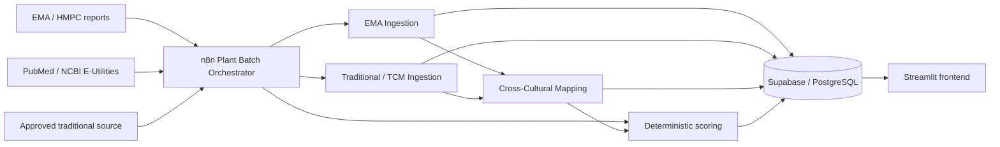

# Architecture

PhyThera separates source ingestion, structured extraction, deterministic scoring, persistent storage, and evidence navigation.

## Components

### Supabase
The persistent relational data layer. It stores plant and indication metadata, source provenance, extraction runs, cross-cultural mapping runs, evidence profiles, and normalized evidence/safety records where available.

### n8n
The workflow orchestration layer. One main Plant Batch Orchestrator coordinates three specialized subworkflows:
1. EMA Ingestion
2. Traditional/TCM Ingestion
3. Cross-Cultural Mapping

The orchestrator also calls PubMed through NCBI E-Utilities, performs screening and scoring logic, writes results to Supabase, and handles missing-source paths.

### LLM-assisted steps
AI is used for tasks where semantic interpretation is useful:
- extracting structured information from complex source documents,
- mapping traditional-use concepts across different medical systems.

### Deterministic steps
Rules rather than LLM judgment are used for:
- Modern Evidence Score,
- Traditional Support Score,
- Evidence Score,
- Evidence Category,
- Source Convergence Score,
- Research Opportunity classification,
- missing-data handling,
- source-policy enforcement.

### Streamlit
A lightweight evidence-navigation interface that ranks plant–indication profiles and exposes source-specific details, safety information, clinical/regulatory evidence, constituents, and cross-cultural mappings.
